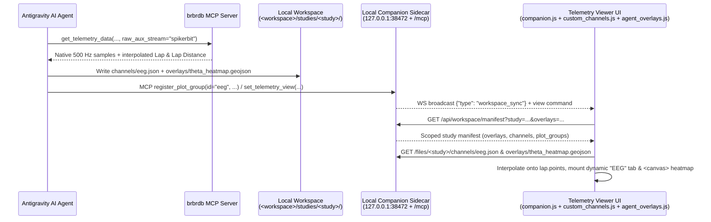

# Local Workspace Studies, Overlays & Custom Channels (`LOCAL_CHANNELS.md`)

**Status**: Implemented  
**Scope**: Enabling AI agents in Antigravity (via `brbrdb` + `companion` MCP servers and `<workspace>/studies/`) to publish custom computed telemetry channels, multi-channel plot groups, and GeoJSON vector/heatmap map overlays into local study folders and render them dynamically in the Telemetry Viewer UI alongside built-in session channels.

---

## 1. Overview & Deployment Topologies

In Antigravity, the Telemetry Viewer runs in either of two topologies (`.agents/plugins/brbrtelemetry/sidecars/telemetry-viewer/server.mjs` / `server.py` and `static/js/kartsim_meeting/companion.js`):

1. **Remote Server + Local Companion Sidecar**: The side-panel `<iframe>` (or browser tab) loads `https://brbrdb.brbrkitten.com/...&companion=1&ws_port=38472`, while the zero-dependency Companion Sidecar runs locally on **`127.0.0.1:38472`** with a live WebSocket (`ws://127.0.0.1:38472/ws`), `Access-Control-Allow-Origin: *`, and `Access-Control-Allow-Private-Network: true`.
2. **Full Local Server**: Flask (`app.py`), `DATA_DIR`, `mcp_server`, and the Companion Sidecar all run on `localhost`.

Because `<workspace>/studies/` is served and watched directly by the local Companion Sidecar (`127.0.0.1:38472`), **workspace studies, GeoJSON map overlays, and custom channel tabs work seamlessly even when viewing sessions hosted on a remote server**.



---

## 2. Multi-Study Workspace Layout & Schemas

By default, the sidecar watches `<workspace>/studies/` (overridable via `BRBR_STUDIES_DIR`, and automatically adopting the agent's workspace via `X-Workspace-Cwd` from the stdio MCP bridge):

```text
<workspace>/
└── studies/
    └── 2026-04-12_buckmore_eeg/
        ├── README.md
        ├── overlays/
        │   ├── braking_markers.geojson
        │   └── theta_heatmap.geojson
        ├── channels/
        │   └── eeg_bands.json
        ├── plot_groups.json
        └── scripts/
            └── compute_eeg_bands.py
```

### Custom Channel Schema (`brbr.custom_channel.v1`)
Channel files in `channels/*.json` may contain a single channel object or `{ "channels": [ ... ] }`. Series are indexed naturally by per-lap track distance (`"align": "distance"`) or session elapsed seconds (`"align": "time"`):

```json
{
  "schema": "brbr.custom_channel.v1",
  "channel_id": "eeg_alpha",
  "label": "EEG Alpha (8-13 Hz)",
  "unit": "uV^2",
  "color": "#a855f7",
  "group": "eeg",
  "group_label": "EEG",
  "match": {
    "date": "2026-04-12",
    "track": "buckmore_park",
    "session_id": "20260412_104512_kibergus"
  },
  "series": [
    {
      "session_id": "20260412_104512_kibergus",
      "driver": "kibergus",
      "lap_num": 14,
      "align": "distance",
      "x": [0.0, 2.0, 4.0],
      "y": [14.2, 13.8, 12.1]
    }
  ]
}
```

### Plot Groups (`plot_groups.json`)
Managed automatically via `register_plot_group(...)` or hand-edited in `<study>/plot_groups.json`:
- Supports `color_mode: "channel"` (channel colors + solid/dash per lap group + interactive channel toggle pills) or `color_mode: "lap"` (group colors).
- Supports primary `y_label`, optional secondary `y2_label` (`yaxis: "y2"`), and optional fixed `y_range: [min, max]`.

### GeoJSON Map Overlays (`overlays/*.geojson`)
- **Vector layers (`metadata.render = "vector"`)**: Dedicated `google.maps.Data` instances per overlay (isolated from track-limits `state.map.data`), supporting `Point`, `LineString`, `Polygon`, feature hover `InfoWindow` tooltips, and 256-entry colormaps (`turbo`, `inferno`, `viridis`, `rdylgn`, `coolwarm`).
- **Heatmap layers (`metadata.render = "heatmap"`)**: Custom `google.maps.OverlayView` `<canvas>` Gaussian kernel renderer supporting physical meter radii (`radius_m`), scalar Nadaraya-Watson interpolation or point-density rendering, and a bottom-left colorbar legend.

---

## 3. Implementation Summary

1. **Companion Sidecar & Stdio MCP Bridge (`.agents/plugins/brbrtelemetry/sidecars/telemetry-viewer/`)**:
   - `server.mjs` and `server.py` (1:1 parity, zero external dependencies): `/api/workspace/studies`, `/api/workspace/manifest`, `/api/workspace`, path-jailed `/files/<subpath>`, 1s `mtime` watcher broadcasting `workspace_sync`, and Streamable HTTP JSON-RPC 2.0 `/mcp` (`set_telemetry_view`, `list_workspace_studies`, `register_plot_group`, `sync_workspace_data`, `get_telemetry_view_status`).
   - `mcp.sh` -> `mcp_stdio.mjs` / `mcp_stdio.py`: Zero-dependency stdio MCP forwarder auto-starting the sidecar if needed and forwarding `process.cwd()` / `os.getcwd()` via `X-Workspace-Cwd`.
2. **High-Rate Aux Stream Export (`mcp_server/session_tools.py` & `mcp_server/server.py`)**:
   - `get_telemetry_data(..., raw_aux_stream="<stream>")` returns native ~500 Hz auxiliary `.brtc` samples with `Lap` and `Lap Distance` interpolated from the primary telemetry stream.
3. **Frontend Dynamic Overlays & Custom Channels (`static/js/kartsim_meeting/`)**:
   - `agent_overlays.js`: Vector & `<canvas>` heatmap layers, map-header `Overlays` + `Study` dropdown, and bottom-left colorbar legend.
   - `custom_channels.js` + `plots_sync.js` + `companion.js` + `lap_selection.js` + `url_sync.js`: Dynamic `.plot-tab` / `.plot-area` mounting, distance/time linear interpolation onto `lap.points`, `mtime` hot-reloading, and `?study=` / `?overlays=` URL state synchronization.
