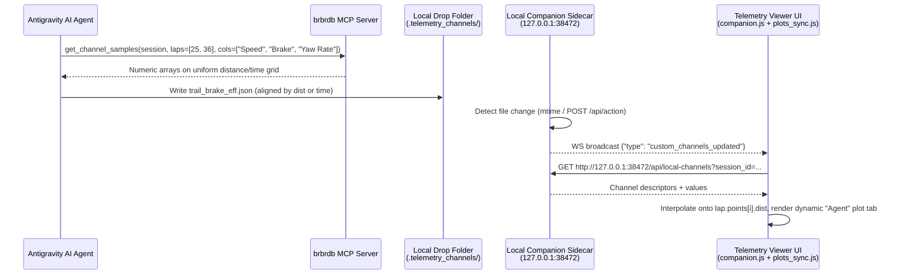

# Local Agent Custom Channels in Antigravity (`LOCAL_CHANNELS.md`)

**Status**: Deferred / Separate Workstream  
**Scope**: Enabling AI agents in Antigravity (via MCP + local filesystem) to publish custom computed channels into a local folder and render them dynamically in the Telemetry Viewer UI alongside regular session channels.

---

## 1. Overview & Deployment Topologies

In Antigravity, the Telemetry Viewer runs in one of two topologies (`.agents/plugins/brbrtelemetry/sidecars/telemetry-viewer/server.py` and `static/js/kartsim_meeting/companion.js`):

1. **Remote Server + Local Companion Sidecar**: The side-panel `<iframe>` loads `https://brbrdb.brbrkitten.com/...&companion=1&ws_port=38472`, while the zero-dependency Companion Sidecar runs locally on **`127.0.0.1:38472`** with a live WebSocket (`ws://127.0.0.1:38472/ws`) and `Access-Control-Allow-Origin: *`.
2. **Full Local Server**: Flask (`app.py`), `DATA_DIR`, MCP (`mcp_server`), and the Companion Sidecar all run on `localhost`.

By serving the **Local Agent Channel Drop-Folder** directly from the **Companion Sidecar (`127.0.0.1:38472`)** (and mirroring the same route on Flask when running locally), **local agent custom channels work seamlessly even when viewing sessions hosted on the remote server (`brbrdb.brbrkitten.com`)**.



---

## 2. Drop-Folder Layout & Agent-Friendly File Format

Configure a watched directory (defaulting to `<workspace>/.telemetry_channels/` or `BRBR_CUSTOM_CHANNELS_DIR`).

An AI agent should **not** need to know internal server row-filter indices (`start_idx..end_idx`). Instead, the local channel format lets the agent index data naturally by **Track Distance (`dist`)** per lap or **Session Timestamp (`time`)**:

```json
{
  "schema_version": 1,
  "channel_id": "trail_brake_efficiency",
  "label": "Trail Brake Efficiency",
  "group": "Agent Analysis",
  "unit": "%",
  "y_range": [0, 120],
  "color_mode": "lap",
  "description": "Ratio of combined braking + cornering G to peak friction circle",
  "match": {
    "date": "2026-11-04",
    "track": "Whilton Mill Zulu",
    "session_id": "20_06_practice"
  },
  "series": [
    {
      "driver": "Katia Guseinova",
      "lap_num": 28,
      "align": "distance",
      "dist": [0.0, 1.0, 2.0],
      "values": [12.4, 14.1, 88.5]
    },
    {
      "driver": "Katia Guseinova",
      "lap_num": 20,
      "align": "distance",
      "dist": [0.0, 1.0, 2.0],
      "values": [11.9, 13.8, 72.1]
    }
  ]
}
```

*(For full-session dense channels, `"align": "time"` with `"time": [...]` + `"values": [...]` or a binary `Float32` sidecar can also be supported.)*

---

## 3. Companion Sidecar & MCP Additions

1. **Companion Sidecar (`sidecars/telemetry-viewer/server.py` & `server.mjs`)**:
   - `GET /api/local-channels?date=...&track=...&session_id=...` $\rightarrow$ scans `.telemetry_channels/*.json`, filters matching `session_id` (or wildcard `*`), and returns channel metadata.
   - `GET /api/local-channels/data?id=<channel_id>` $\rightarrow$ serves the channel payload with `Access-Control-Allow-Origin: *`.
   - Poll directory `mtime` once per second (pure stdlib, zero dependencies) and support `POST /api/action` `{"type": "reload_custom_channels", "plots": ["agent:trail_brake_efficiency"]}` so the agent can create a channel and automatically open/zoom its plot in the side panel in one turn.

2. **MCP Numeric Sample Export (`get_channel_samples` in `mcp_server/`)**:
   - Currently, `get_telemetry_plot` returns PNG images, so an agent connected to a remote MCP server cannot easily compute custom math on raw arrays.
   - Add `get_channel_samples(date, track, session_id, laps, channels, grid_step_m=1.0)` returning compact numeric arrays on a uniform distance grid (`1.0 m` $\approx$ 1,000 floats/lap) so the agent can fetch exact numbers, run Python signal processing in a scratch script, and write the output to `.telemetry_channels/`.

---

## 4. Frontend Dynamic Channel & Plot Registry

Today, adding any new plot channel to the UI requires editing five hardcoded locations:
1. `<button class="plot-tab" data-tab="...">` in `templates/kartsim_meeting.html:321-332`.
2. `<div id="plot-area-..." class="plot-area">` in `templates/kartsim_meeting.html:347-366`.
3. `COLUMN_MAPPINGS` and `CHANNEL_AVAILABILITY` in `static/js/kartsim_meeting/plots_sync.js:35-95`.
4. `ensureChannelLoaded()` and `lazyTabs` in `plots_sync.js:97-130, 1694`.
5. Resize observer arrays in `static/js/kartsim_meeting/lap_selection.js:703-707`.

### Proposed Refactor (`channel_registry.js`)
- Keep existing specialized layouts for the 10 built-in groups (`pedals`, `steering`, `rps`, `gforce`, `gyro`, `slide`, `patch_vel`, `force`, `tyre_load`, `slip_angle`).
- Add dynamic tab/container mounting for custom channel descriptors discovered from `http://127.0.0.1:38472/api/local-channels` (or `/api/telemetry`), interpolating custom series onto `targetLap.points[i]` via `p.dist` or `p.time` so they work natively with cursor hover, distance scrubbing, `xlim` zoom, and companion commands.

