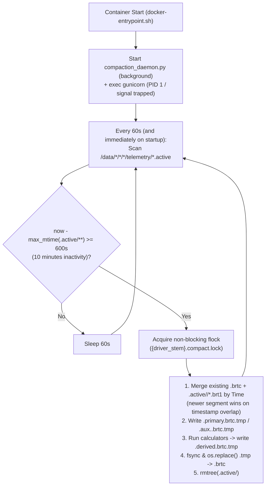

# Telemetry Storage, Wire Formats & Multi-Stream Ingestion Plan

**Status**: Finalized Architectural Plan (`STORAGE.md`)  
**Scope**: Multi-block channel wire & storage format, `.brtc` columnar persistence, multi-stream `BRT1` upload with 1-minute reconnect resilience, 10-minute inactivity compaction daemon in Docker, and versioned computed channels.  
*(Note: Local agent custom channels in Antigravity are tracked separately in `LOCAL_CHANNELS.md`.)*

---

## Executive Summary

Today, telemetry uses three separate representations:
1. **`BRT1` (`POST /api/upload/stream`)**: Row-oriented binary upload stream (`upload_handlers.py:1610-1711`), currently decoded in Python and rewritten to a monolithic RaceTools CSV every 15 seconds ($O(N^2)$ write amplification).
2. **RaceTools CSV (`{meeting_dir}/telemetry/*.csv`)**: Currently the sole persistent disk format (**55–65 MB** per 30-minute session at 100 Hz), mixing raw and derived columns irreversibly.
3. **Browser Serving Binary Format (`GET /api/telemetry/channel`)**: Single-block `16 + 2N` `int16` delta array generated on **every** HTTP request by re-scanning and tokenizing the entire 60 MB CSV file in C++ (`native/telemetry_native.cpp:158-431`).

### Core Architectural Decisions

| Area | Finalized Decision |
| :--- | :--- |
| **Per-Channel Sample Rates** | **No end-to-end multi-rate in serving API or JS UI.** `start_idx..end_idx`, C++ row alignment, and JS `lap.points[i]` remain strictly 1-to-1 index aligned. Secondary streams (`stream != ""`) with different/irregular cadences store native timestamps in their own raw `.aux.<stream>.brtc` files and resample/extract onto the primary stream's $N$-row `Time` grid in `.derived.brtc`. |
| **Unified Wire & `.brtc` Column Format** | Upgrade channel payloads (both `/api/telemetry/channel` and `.brtc` column blocks) to a **Brotli-compressed sequence of `<offset, scale, count, deltas[]>` 16-bit delta blocks**. Starting a new block whenever a jump exceeds `±32767 * scale` preserves exact `Time` precision across arbitrarily long pit pauses while allowing **direct byte streaming (`pread`)** from `.brtc` to the browser. Decoders never assume a fixed `scale` — they always read `scale` from each block header. |
| **Read-Time C++ Post-Processing** | Keep existing C++ read-time post-processing (`Speed *= 3.6` from `m/s` $\rightarrow$ `km/h` and KartSim 5-point moving average `should_smooth`) as-is. Unmodified channels (~85% of requests) stream raw Brotli bytes straight off disk; `Speed` and smoothed KartSim channels decode only that single `.brtc` column in C++, post-process, and re-compress. |
| **Streaming, Backward Compatibility & Reconnects** | **100% backward compatible with all existing upload clients.** Primary streams always have `"stream"` omitted or empty (`""`) in `BRT1` metadata; secondary streams set a non-empty `"stream"` name (e.g. `"eeg"`). Clients may bundle all channels in the primary stream (`""`) or split secondary streams. Each HTTP connection writes directly to its own append-only `.brt1` segment file on disk (**zero cross-request RAM buffering, zero mutexes between handlers, zero intermediate CSV**). |
| **10-Minute Compaction Daemon** | Run a lightweight compaction daemon inside the Docker container alongside Gunicorn. After **10 minutes of inactivity** on a session's `.active/` directory, compact segments into `.brtc` files and delete `.active/` (and delete legacy `.csv` files upon migration). Viewing an uncompacted `ACTIVE` session converts `.active/` `BRT1` segments to `.brtc` structures on demand without any intermediate CSV. |
| **Separate Files & Computed Channels** | Store `{stem}.primary.brtc` ($N$ rows), optional `{stem}.aux.<stream>.brtc` ($M_k$ rows), and `{stem}.derived.brtc` ($N$ rows) as **separate single-cadence files**. Stamp `.derived.brtc` with calculator `(algo_id, version, deps_hash)` so algorithm updates atomically regenerate only `.derived.brtc`. |

---

## 1. Per-Channel Discretization Rates: Why End-to-End Multi-Rate Is Avoided

Supporting different sample rates per channel in `/api/telemetry/channel` and the frontend viewer would require rewriting four tightly coupled subsystems:
1. **Index-Aligned Channel Endpoint (`location_handlers.py` $\leftrightarrow$ `telemetry_native.cpp`)**: `/api/telemetry` defines laps via `(start_idx, end_idx)` row indices, and `/api/telemetry/channel` returns bare value arrays without timestamps or distances.
2. **GPS Row Filtering (`native/telemetry_native.cpp:301-333`)**: Drops rows missing `Time`, `Latitude`, `Longitude`, or `Lap`, or falling outside the track bounding radius.
3. **Frontend Point Structs (`lap.points[i]`)**: `map.js:507-516`, `telemetry.js:240-369`, `plots_sync.js:172-179, 646-1077`, and `video_player.js:522-611` assume all channels coexist on `lap.points[i]` for distance interpolation, `j += 4` subsampling, cross-channel math (`Math.hypot(gx, gy)`, Slip Angle vs. Force phase plots), and video sync.
4. **Kinematic Fusion (`upload_handlers.py:555-785`)**: `compute_gyro_rear_slip_angle()` and `compute_gyro_forces()` fuse `Yaw Rate`, `GForce*`, `Speed`, and GPS `course` sample-by-sample.

**Resolution**:
- Every upload stream carries its own `Time` channel (no `sample_rate_hz` metadata or uniform client cadence required; host clock / NTP provides wall-clock alignment).
- Raw secondary streams (non-empty `"stream"` name) preserve their native timestamps and row count $M_k$ in `{stem}.aux.<stream>.brtc`.
- Any channel served to the UI or cross-plotted against track distance is materialized onto the primary stream's canonical $N$-row `Time` grid inside `{stem}.derived.brtc`.

---

## 2. Multi-Block Channel Wire Format & `.brtc` Storage Spec

### 2.1 Multi-Block `16-Bit` Delta Payload (Shared by Browser Wire & `.brtc` Columns)

Both `/api/telemetry/channel` responses and individual column payloads inside `.brtc` use the **exact same Brotli-compressed (Quality 4) binary stream** consisting of one or more sequential blocks concatenated until EOF:

```
+-----------------------------------------------------------------------------------+
| Block 0:                                                                          |
|   offset : float64_le (8 bytes)  -- Exact value of first valid sample in block    |
|   scale  : float64_le (8 bytes)  -- Step quantization factor (> 0.0)              |
|   count  : uint32_le  (4 bytes)  -- Number of samples K in this block (K >= 1)    |
|   deltas : int16_le[K] (2*K B)   -- -32768 = NaN/null; else cumulative step delta |
+-----------------------------------------------------------------------------------+
| Block 1 (emitted only if |val - last_val| > 32767 * scale):                       |
|   offset : float64_le (8 bytes)                                                   |
|   scale  : float64_le (8 bytes)                                                   |
|   count  : uint32_le  (4 bytes)                                                   |
|   deltas : int16_le[K2]                                                           |
+-----------------------------------------------------------------------------------+
```

#### Key Properties:
1. **2-Byte Alignment Guaranteed**: Every block header is `20 bytes`, and `2 * K` is always even. Every `deltas` array starts at an even byte offset, allowing zero-copy `new Int16Array(arrayBuffer, pos + 20, count)` views in JavaScript!
2. **Reconstruction Formula**:
   - Within each block, initialize `currentQuantized = 0`.
   - For the first valid sample in the block: `deltas[i] = 0` $\rightarrow$ `value = offset`.
   - For subsequent valid samples in the block: `currentQuantized += deltas[i]` $\rightarrow$ `value = offset + currentQuantized * scale` (note `currentQuantized` is `int64` in C++ and `Number`/`float64` in JS, so it never overflows `int16` across monotonic drifts).
   - For `deltas[i] == -32768`: `value = NaN` (`null` in JS), preserving `currentQuantized` across `NaN` gaps.
3. **Exact `Time` Without Special Columns (Header-Driven `scale`)**:
   - **Rule**: Decoders (C++, Python, and JS) **must never hardcode or assume** `scale == 0.0001` (or `0.001`) for `Time` or any other channel — `scale` is **always** read dynamically from each block's `<offset, scale, count>` header (just as `BRT1` decoders read each channel's `scale` from the `0x02` header).
   - When encoding `Time` (seconds since `00:00:00` of session start date) into `.brtc`, the encoder chooses a fine step scale (e.g. preserving the `BRT1` header's `Time` `scale` or defaulting to `0.0001` for CSV imports; at `0.0001`, max single-tick step is `±3.2767 s`, or `±32.767 s` at `0.001`).
   - Whenever a pit pause or stream reconnect exceeds `±32767 * scale`, the encoder simply starts a **new block** with an exact `float64` `offset`, preserving full timestamp fidelity everywhere.
4. **Bounded Sensor & GPS Channels**:
   - Bounded channels (`Speed`, `Throttle`, `Brake`, `Steering`, `GForce*`, `Yaw Rate`, `Latitude`, `Longitude`, `Lap Distance`) normally emit **1 single block** for the entire session (`20 + 2N` bytes raw), using `scale = span / 32760.0` (or `max_step / 32760.0` if smaller with block splits on extreme outliers), achieving `1.5 cm` GPS resolution and `< 0.004 km/h` speed resolution.
5. **JS Decoder Updates**:
   - Update both `fetchTelemetryChannel()` in `static/js/kartsim_meeting/telemetry.js:414-452` and `TelemetryPlot.parseBinaryFloat64()` in `static/js/telemetry_plot.js:48-70` to loop `while (pos + 20 <= arrayBuffer.byteLength)` reading `<offset, scale, count, deltas[count]>`.

### 2.2 `.brtc` Container Layout

Each `.brtc` file represents **one single-cadence table** (`row_count` rows):

```
+-------------------------------------------------------------------------+
| Magic Header: "BRTC\x01\x00\x00\x00" (8 bytes)                          |
+-------------------------------------------------------------------------+
| Column 0 Payload: Brotli-compressed multi-block <offset, scale, count>  |
| Column 1 Payload: Brotli-compressed multi-block <offset, scale, count>  |
| ...                                                                     |
+-------------------------------------------------------------------------+
| JSON Manifest (UTF-8, Brotli-compressed):                               |
|   {                                                                     |
|     "version": 1,                                                       |
|     "row_count": 179511,                                                |
|     "metadata": { "driver_name": "...", "session_start_datetime": "..." },|
|     "laps": [ {"lap_num": 1, "start_idx": 0, "end_idx": 2539, ...} ],   |
|     "calculators": { "gyro_rear_slip": {"version": 1, "deps": "..."} }, |
|     "columns": {                                                        |
|       "Time":     {"offset": 8,      "length": 48210},                  |
|       "Latitude": {"offset": 48218,  "length": 91400},                  |
|       "Speed":    {"offset": 139618, "length": 112050}                  |
|     }                                                                   |
|   }                                                                     |
+-------------------------------------------------------------------------+
| Footer (16B): [manifest_offset: u64_le][manifest_len: u32_le]["BRTC"]   |
+-------------------------------------------------------------------------+
```

### 2.3 Separate `.brtc` Files per `(Session, Driver)`

Under `{meeting_dir}/telemetry/`:
1. **`{driver_stem}.primary.brtc`** ($N$ rows): Raw channels from the primary stream (`stream == ""`) in their native units (`Speed` in `m/s`, unsmoothed KartSim forces/G-forces), filtered once for valid GPS/Time rows.
2. **`{driver_stem}.aux.<stream>.brtc`** ($M_k$ rows, only if secondary streams were uploaded): Native-cadence raw channels from a named secondary stream (`stream == "<stream>"`, non-empty) with no GPS row filtering.
3. **`{driver_stem}.derived.brtc`** ($N$ rows): Computed channels (`Lap`, `Lap Distance`, `Kart Heading`, `Yaw`, `Slip Angle*`, `Lat/Long Force*`) + any channels resampled/extracted from `.aux.<stream>.brtc` onto the primary stream's $N$-row `Time` grid, plus pre-indexed `laps[]` metadata in its manifest.

### 2.4 Serving `GET /api/telemetry/channel` (Direct `pread` vs. C++ Post-Processing)

When a browser requests `channel` for a compacted session:
1. Look up `channel` in `{driver_stem}.derived.brtc` first, falling back to `{driver_stem}.primary.brtc`.
2. **Zero-Copy Fast Path (~85% of requests)**: If `channel.lower() != "speed"` and not `(league == "kartsim" and _should_smooth_channel(channel))`:
   - Read exact compressed bytes via `os.pread(fd, col_length, col_offset)` and return immediately with `Content-Encoding: br`!
3. **C++ Post-Processing Path (`Speed` or KartSim `should_smooth` channels)**:
   - Keep existing C++ post-processing logic intact: C++ reads just that single compressed column slice (`col_offset..col_offset+col_length`), Brotli-decompresses and decodes the `int16` blocks into `std::vector<double>`, applies `val *= 3.6` (`Speed`) or 5-point moving average `smooth_values()`, and re-encodes + Brotli-compresses (~`2 ms` total vs. scanning a 60 MB CSV).

---

## 3. Multi-Stream Upload, 1-Minute Reconnects & Active Reading

### 3.1 `BRT1` Metadata (`0x02`) `"stream"` Convention & Backward Compatibility

- **Convention — Empty Stream Name for Primary Stream**:
  - Primary streams **always** have `"stream"` omitted or set to `""` (empty string) in `0x02` `metadata`.
  - Secondary streams specify a non-empty sanitized `"stream"` identifier (e.g. `"eeg"`, `"eye"`).
  - Clients remain free to send all channels (including biometrics) inside the primary stream (`""`), or split secondary streams into separate connections.
- **100% Backward Compatibility with Existing Upload Clients**:
  1. **Existing `BRT1` streaming clients (`POST /api/upload/stream`)**: Omit `"stream"` (and send e.g. `"scale": 0.001` for `Time`) $\rightarrow$ normalized to `stream = ""` (primary) with **zero client changes**.
  2. **Existing CSV streaming clients (`POST /api/upload/stream`)**: Auto-detected via `reader.peek(7) != b'\x04\x00\x01BRT1'`, normalized to `stream = ""` (primary), and transcoded on the fly into `.active/` binary segments with **zero client changes**.
  3. **Existing file upload clients (`POST /api/upload/files`, RaceBox BLE uploader, web upload UI)**: Unchanged HTTP request/response contract; parsed directly into `.brtc` files on disk.
- Support fractional seconds in metadata `"Time"` (e.g. `"18:30:00.125"`) when present (while continuing to accept `"HH:MM:SS"` and `"HH:MM"` from existing clients).
- Primary and secondary streams execute **shared, reusable upload functions** (header parsing, ACL check, path validation, and segment writing).

### 3.2 Disk Segment Writing (Zero RAM Buffering, Zero Cross-Handler Mutexes, Zero Intermediate CSV)

1. **`POST /api/upload/stream`**:
   - Maps `stream == ""` to internal subdirectory `_primary` and `stream == "<name>"` to `aux_<name>`, streaming incoming `BRT1` chunks directly onto disk in a per-connection segment file:
     `{meeting_dir}/telemetry/{driver_stem}.active/{subdir}/{arrival_unix_ms}_{uuid}.brt1`
     *(If legacy ASCII CSV is streamed to `/api/upload/stream`, transcode rows on the fly into `BRT1` chunks written to the `.active/_primary/` segment file — never write a `.csv` to disk.)*
   - **Why per-connection segment files**: Clients routinely drop and re-establish connections every ~1 minute. Under multi-worker Gunicorn, an old half-open socket on Worker 1 and a newly reconnected socket on Worker 2 write to distinct segment files with **zero `flock` stalls, zero shared mutexes, and zero cross-request RAM buffering**.
   - **Live Leaderboard Updates**: When `stream == ""` (and GPS or simulator `x, z` channels are present), periodic 15s flushes update `{session_filename}_metadata.json`, `{session_filename}.csv` lap summary (under `summary_path.lock`), and PostgreSQL `populate_single_session()`.
2. **`POST /api/upload/files` (One-Shot Complete File Uploads)**:
   - Since uploaded files are already complete, parse in memory and write `.primary.brtc` + `.derived.brtc` directly — **no `.csv` file written to disk**.

### 3.3 Reading Uncompacted (`ACTIVE`) Sessions & MCP Compatibility

1. **Web UI Access Before 10-Minute Compaction**:
   - If `{driver_stem}.active/` exists when `/api/telemetry` or `/api/telemetry/channel` is called, convert `(existing .brtc + .active/ segments)` on demand into an in-memory / ephemeral `.brtc` representation (optionally cached in `/tmp` keyed by `(session_path, max_mtime_ns, total_bytes)` so the 9–15 parallel channel requests of a single page load share one conversion) — **zero intermediate CSV**.
2. **MCP Tools (`mcp_server/`) & On-Demand CSV Export**:
   - Update `mcp_server/session_tools.py`, `lap_tools.py`, and `image_tools.py` to read manifests, lap bounds, and NumPy channel arrays through a unified `telemetry_store` reader supporting both `.brtc` and `.active/` sessions.
   - For any MCP tool or HTTP download route (`GET /api/telemetry/export_csv`) that needs RaceTools CSV text, format CSV rows on the fly in memory from `.brtc` columns without persisting `.csv` on disk.

---

## 4. Docker Compaction Daemon & Legacy CSV Migration

### 4.1 Resilient In-Container Compaction Daemon (`compaction_daemon.py`)



- **Docker Integration (`Dockerfile` & `docker-compose.yml`)**:
  - Add `docker-entrypoint.sh` that launches `python -m utils.compaction_daemon` in the background and runs `gunicorn` with `SIGTERM`/`SIGINT` forwarding so everything runs inside the existing `karting-analysis` container with zero external cron dependencies.
- **Restart & Crash Safety**:
  - All state is derived from filesystem `.active/` segment `mtime`s on `/data`. If the container restarts mid-session or mid-compaction, the startup scan picks up abandoned `.tmp` files, waits until `now - max_mtime >= 600s`, and completes compaction cleanly.
  - If a client re-uploads hours after compaction, new segments simply create `{driver_stem}.active/` again; 10 minutes after the re-upload finishes, the daemon merges the existing `.brtc` with the new segments and replaces `.brtc`.

### 4.2 Existing Archive Migration (`utils/compact_sessions.py`)

- Provide a batch CLI `python -m utils.compact_sessions` to scan `/data/*/*/*/telemetry/*.csv`:
  1. Strip previously baked-in derived columns (`Lap`, `Lap Distance`, `Kart Heading`, `Yaw`, `Slip Angle*`, IMU `Lat/Long Force Front/Rear`) to recover clean raw columns into `{driver_stem}.primary.brtc`.
  2. Run the calculator pipeline to write `{driver_stem}.derived.brtc`.
  3. Verify row counts and lap summaries, then **delete** the legacy `.csv` file (~90% disk space reduction).

---

## 5. Versioned Computed Channels (`{driver_stem}.derived.brtc`)

Extract derivative calculations out of `upload_handlers.py` into a declarative `telemetry_calculators.py` registry:

1. **`sim_local_to_gps` (`v1`)**: Simulator `(x, z)` + `track.origin` $\rightarrow$ `Latitude`, `Longitude` (when raw GPS is absent).
2. **`track_lap_indexing` (`v1`)**: `Latitude`, `Longitude`, `Time` + `track_centerline_sha256` $\rightarrow$ `Lap`, `Lap Distance`, `laps[]` (`start_idx`, `end_idx`, `sector_times`, `turn_times`).
3. **`sim_quat_kinematics` (`v1`)**: `Ori Quat X/Y/Z/W`, `Toe FL/FR` $\rightarrow$ `Kart Heading`, `Yaw`, `Slip Angle Rear`, `Slip Angle Front`.
4. **`gyro_rear_slip` (`v1`)**: `Yaw Rate`, `Speed`, `GForceLat` + `distance_to_rear_axle` $\rightarrow$ `Kart Heading`, `Yaw`, `Slip Angle Rear` *(skipped if `Slip Angle Rear` exists in `.primary.brtc`)*.
5. **`gyro_axle_forces` (`v1`)**: `Yaw Rate`, `GForceLat`, `GForceLon`, `Steering` $\rightarrow$ `Lat Force Front/Rear`, `Long Force Front/Rear` *(skipped if native forces exist in `.primary.brtc`)*.

Each entry in `{driver_stem}.derived.brtc`'s manifest records `{"version": V, "deps_hash": "..."}` (hashing relevant session metadata + track geometry). When an algorithm version increments or track geometry changes, `utils/recompute_channels.py` (or lazy check on read) regenerates **only** `{driver_stem}.derived.brtc` from `{driver_stem}.primary.brtc` / `.aux.*.brtc`.

---

## 6. Implementation Sequence

1. **Phase 1 — Multi-Block Wire Format & `.brtc` Core (C++ + Python + JS)**:
   - Implement multi-block `<offset, scale, count, deltas[]>` encoder/decoder and `.brtc` container reader/writer in `native/telemetry_native.cpp` + Python `telemetry_store.py`.
   - Update JS decoders in `static/js/kartsim_meeting/telemetry.js` and `static/js/telemetry_plot.js`.
   - Update `location_handlers.py` (`/api/telemetry`, `/api/telemetry/channel`, plus `/api/telemetry/export_csv`) with dual-read support (`.brtc` first, legacy `.csv` fallback during transition).
2. **Phase 2 — Calculator Registry & CSV Archive Compaction CLI**:
   - Extract `telemetry_calculators.py` + `utils/recompute_channels.py` and `utils/compact_sessions.py` (converting `.csv` $\rightarrow$ `.primary.brtc` + `.derived.brtc` and deleting `.csv`).
   - Update `app.py` (video marker sync) and `mcp_server/` (`session_tools.py`, `lap_tools.py`, `image_tools.py`) to read via `telemetry_store.py`.
3. **Phase 3 — Multi-Stream `.active/` Ingestion & Docker Compaction Daemon**:
   - Refactor `upload_handlers.py` (`stream_upload` with `"stream"` metadata + `.active/<stream>/*.brt1` segment writer, `files_upload` direct-to-`.brtc`, zero intermediate CSV) and on-demand `.active/` reader cache.
   - Add `utils/compaction_daemon.py` + `docker-entrypoint.sh` (`Dockerfile` / `docker-compose.yml`).
   - Validate full Python & JS test suites via `./test.sh`.
