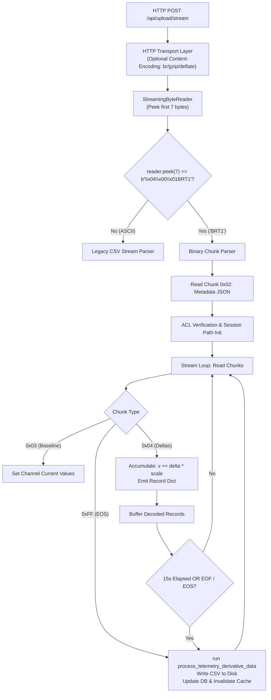

# Real-Time Streaming Binary Telemetry Upload Protocol (BRT1)

## Overview & Background

This document specifies the **BRT1 (Binary Race Telemetry v1)** protocol for streaming live telemetry into the server via `POST /api/upload/stream`.

### Key Design Decisions:
1. **Transport-Level HTTP Compression**: The entire stream is compressed using standard HTTP compression (`Content-Encoding: br`, `gzip`, or `deflate`), avoiding per-chunk compression flags on the wire.
2. **Unified Chunk Framing**: Every unit in the stream shares the exact same 3-byte chunk header:
   $$\text{[Chunk Length (2B, uint16\_le)]} \;+\; \text{[Chunk Type (1B, uint8)]} \;+\; \text{[Payload (Length bytes)]}$$
3. **Magic Chunk Inside Stream**: Protocol identification is carried in a dedicated initial Magic Chunk (`Type 0x01`, payload `b'BRT1'`), unifying stream discovery into the chunk parser.
4. **Real-Time Streaming (Row-Oriented)**: Telemetry is transmitted sample-by-sample as it is generated with zero client-side buffering latency (no columnar buffering needed).
5. **16-Bit Deltas with Fixed Scales**: Telemetry deltas use 16-bit signed integers (`int16_le`). Quantization step sizes (`scale`) are defined once per channel in the metadata JSON header. `-32768` (`0x8000`) is reserved for `NaN` (missing values).

---

## Wire Format Architecture

A BRT1 stream consists of a continuous sequence of framed chunks:

```
+-------------------------------------------------------------------------------+
| Length (2B, uint16_le) | Type (1B, uint8) | Payload (Length bytes)           |
+-------------------------------------------------------------------------------+
```

- **`chunk_len`** (`uint16_le`, 2 bytes): Length of `payload` in bytes ($0 \le \text{length} \le 65535$).
- **`chunk_type`** (`uint8`, 1 byte): Identifies chunk content.
- **`payload`** (`bytes`): Raw chunk data.

### Chunk Types

| Type Code | Name | Description |
| :---: | :--- | :--- |
| **`0x01`** | **Magic Chunk** | Identifies protocol version (`b'BRT1'`). Sent as the very first chunk. |
| **`0x02`** | **Metadata JSON Chunk** | Session metadata & channel schema with fixed scales. Usually sent immediately after magic. |
| **`0x03`** | **Baseline / Keyframe Chunk** | Full-precision absolute values (`float64_le` for each channel). Sets initial values or resyncs stream. |
| **`0x04`** | **Telemetry Delta Chunk** | One or more samples of 16-bit signed deltas ($M \times \text{int16\_le}$ per sample). |
| **`0xFF`** | **End of Stream (EOS) Chunk** | Explicitly signals the end of the telemetry stream. |

---

## Detailed Chunk Specifications

### 1. Magic Chunk (`Type 0x01`)
- **`chunk_len`**: `4` (`0x0004`)
- **`chunk_type`**: `0x01`
- **`payload`**: Constant ASCII `BRT1` (`0x42 0x52 0x54 0x31`)

Total size on wire: **7 bytes** (`04 00 01 42 52 54 31`).

---

### 2. Metadata JSON Chunk (`Type 0x02`)
- **`chunk_len`**: Byte length of the JSON string.
- **`chunk_type`**: `0x02`
- **`payload`**: UTF-8 encoded JSON object.

#### JSON Structure:
Metadata fields match the canonical CSV format headers (`Track name`, `Date`, `Time`, `Driver name`, `League`, `Class`, `Session`, etc.):
```json
{
  "metadata": {
    "Track name": "Rowrah",
    "Date": "2026-05-10",
    "Time": "14:30:00",
    "Driver name": "Driver A",
    "League": "kartsim",
    "Class": "cadet",
    "Session": "Practice",
    "kart_number": "12",
    "Distance to rear axle": 1.5,
    "Conditions": "Dry",
    "Temperature": "18.0",
    "Weather": "Sunny"
  },
  "channels": [
    {"name": "Time", "scale": 0.001},
    {"name": "Latitude", "scale": 1e-7},
    {"name": "Longitude", "scale": 1e-7},
    {"name": "Speed", "scale": 0.01},
    {"name": "Throttle", "scale": 0.1},
    {"name": "Brake", "scale": 0.1},
    {"name": "Steering Angle", "scale": 0.05},
    {"name": "GForceLat", "scale": 0.001},
    {"name": "GForceLon", "scale": 0.001},
    {"name": "GForceVert", "scale": 0.001},
    {"name": "Yaw Rate", "scale": 0.001},
    {"name": "Pitch Rate", "scale": 0.001},
    {"name": "Roll Rate", "scale": 0.001},
    {"name": "Lap", "scale": 1.0}
  ]
}
```

#### Standard Channel Scales & Resolutions:
Because deltas are 16-bit signed integers (range: $\pm 32767$), fixed scales provide high precision while preventing overflows across consecutive samples:

| Channel Name | Scale (`scale`) | Resolution | Max Change per Sample ($\pm 32767 \times \text{scale}$) |
| :--- | :--- | :--- | :--- |
| `Time` | `0.001` | 1 millisecond | $\pm 32.767$ seconds |
| `Latitude` / `Longitude` | `1e-7` | ~1.1 cm | $\pm 0.00327^\circ$ (~360 meters) |
| `Speed` | `0.01` | 0.01 m/s (0.036 km/h) | $\pm 327.67$ m/s (~1180 km/h) |
| `Throttle` / `Brake` | `0.1` | 0.1 % | $\pm 3276.7\%$ |
| `Steering Angle` | `0.05` | 0.05 degrees | $\pm 1638.35^\circ$ |
| `GForceLat` / `Lon` / `Vert` | `0.001` | 0.001 g | $\pm 32.767$ g |
| `Yaw Rate` / `Pitch` / `Roll`| `0.001` | 0.001 rad/s (or °/s) | $\pm 32.767$ rad/s |
| `Lap` | `1.0` | 1 lap | $\pm 32767$ laps |

---

### 3. Baseline / Keyframe Chunk (`Type 0x03`)
Establishes the absolute baseline values for all $M$ channels. Sent at stream start and optionally re-sent periodically (e.g. every 30s or on GPS relock) to reset quantization accumulation.

- **`chunk_len`**: $M \times 8$ bytes (where $M$ is the number of declared channels).
- **`chunk_type`**: `0x03`
- **`payload`**: $M$ contiguous IEEE 754 double-precision floats (`float64_le`).
  - Standard IEEE `NaN` is used if a channel is uninitialized/missing.
  - The number and order of values must match the declaration in the header. 

---

### 4. Telemetry Delta Chunk (`Type 0x04`)
Streams telemetry samples in real time as they are captured.

- **`chunk_len`**: $N \times M \times 2$ bytes, where $N \ge 1$ is the number of samples in this chunk, and $M$ is the number of channels.
  - For real-time streaming, $N=1$ (single sample transmitted immediately).
  - Can also hold $N > 1$ samples if the client network stack or logger buffers a small batch (e.g. 50 ms).
- **`chunk_type`**: `0x04`
- **`payload`**: Sequence of samples, each consisting of $M$ contiguous `int16_le` signed deltas:
  $$\Delta q_i = \text{round}\left(\frac{v_i - v_{i-1}}{\text{scale}}\right)$$
  - **Special Value `-32768` (`0x8000`)**: Indicates `NaN` / missing value.
  - Matches the decoder logic:
    $$v_i = \begin{cases} \text{null/NaN}, & \text{if } \Delta q_i = -32768 \\ v_{i-1} + \Delta q_i \times \text{scale}, & \text{otherwise} \end{cases}$$
  - The number and order of values must match the declaration in the header.
  - If a chanel switches from `NaN` to `non-NaN` the sample has to be encoded as Keyframe `0x03` chunk. 

---

### 5. End of Stream (EOS) Chunk (`Type 0xFF`)
Explicitly signals that the client has completed streaming telemetry data for this session.

- **`chunk_len`**: `0` (or optional diagnostic/status payload).
- **`chunk_type`**: `0xFF`
- **`payload`**: Empty by default.

---

## Bandwidth & Streaming Comparison

For a typical 100 Hz kart telemetry stream with 12 channels:

| Format | Packet Size (1 sample) | Bandwidth (100 Hz uncompressed) | Bandwidth (HTTP Brotli/Gzip) |
| :--- | :--- | :--- | :--- |
| **Legacy CSV** | ~180–220 bytes | 18–22 KB/s (~75 MB / hour) | 4–6 KB/s |
| **BRT1 (16-bit deltas)** | **27 bytes** (3B header + 24B payload) | **2.7 KB/s** (~9.7 MB / hour) | **~0.4–0.8 KB/s** (~2 MB / hour) |

- **Zero Client Buffering**: Client writes 27 bytes per 10 ms tick straight to the HTTP socket.
- **Immediate Server Decoding**: Server decodes 27 bytes with vector addition in microseconds.

---

## Server Implementation Architecture



### Server Components:

1. **`StreamingByteReader`**:
   - Implements streaming byte and line buffering logic in `upload_handlers.py` supporting `read_exact(n: int) -> bytes`, `peek(n: int) -> bytes`, `readline() -> str | None`, and `read_chunk() -> tuple[int, bytes] | None`.
   - Handles decompression transparently using standard `Content-Encoding: br`, `gzip`, or `deflate`.

2. **Auto-Format Detection**:
   - The reader inspects the first 7 bytes via `reader.peek(7) == b'\x04\x00\x01BRT1'`.
   - Otherwise, it falls back to the legacy CSV line reader.

3. **15-Second Server Batching & Real-Time Support**:
   - Decoded records are appended to `all_raw_records` immediately.
   - The 15-second timer batches heavy database updates, centerline projection, and disk CSV writes.
   - A hook point is provided in the decode loop so future real-time publishers (WebSockets / SSE) can forward each decoded record instantly with sub-millisecond latency.
